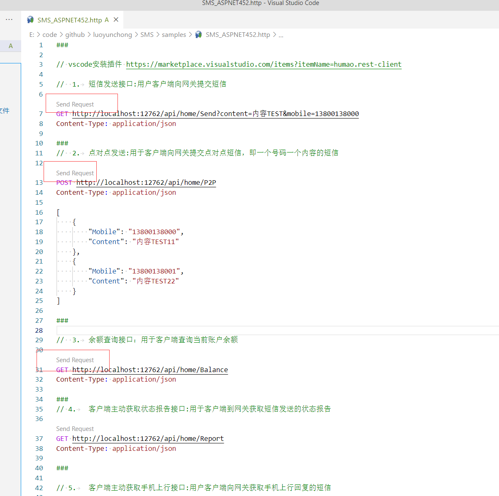

**English** | [简体中文](README.md)

# Ronghe Yunxin

Ronghe Yunxin is **China Unicom**'s SMS platform, offering stable service at large scale.
- Large-scale delivery: coverage across China's three major carriers, with two-way SMS support
- Organization management: unified billing and access controls for multiple accounts, with multilevel management
- Operations and monitoring: service health, topology, visualized call tracing, and multidimensional analysis to help prevent system failures

### Website [https://maap.wo.cn/index.html](https://maap.wo.cn/index.html)

See the [English Ronghe Yunxin HTTP API reference v1.7.2](../../docs/Ronghe-Yunxin-HTTP-v1.7.2.en.md) ([Chinese original](../../docs/融合云信平台HTTP接口文档_V1.7.2.doc)); the latest documentation and user manual are also available from the official website.

## Nuget Packages

| Package name| Version| Downloads| Supported platforms                                                                         |
|  ------------ |  ------------ |  ------------ | ------------|
| `IGeekFan.SMSUnicom` | [](https://www.nuget.org/packages/IGeekFan.SMSUnicom/) |  |.NET4.5.2/.NETStandard2.0


## Usage

### .NET Core

Install the package
```console
dotnet add package IGeekFan.SMSUnicom
```

appsettings.json configuration
```json
  "SMSUnicomOption": {
    "Cpcode": "",
    "Accesskey": "",
    "Excode": "",
    "SmsUrl": "http://rcsapi.wo.cn:8000",
    "SendMessageTemplateId": "57331"
  }
```
- `Cpcode` Sign in to the self-service platform and use the merchant code from the merchant information page as cpcode.
- `Accesskey` Sign in to the self-service platform and use the AccessKey from system settings as the key.
- `Excode` Extension code for the channel's custom access number; optional. Pass an empty string if unused.
- `SmsUrl` Ronghe Yunxin API URL; ask your provider or consult the latest documentation.
- `SendMessageTemplateId` Optional application-defined value used below to identify the SMS template; request a template on the provider's website.

### Configure the SMS options
```csharp
builder.Services.Configure<SMSUnicomOption>(builder.Configuration.GetSection("SMSUnicomOption"));
```
### Register the SMS service
```csharp
builder.Services.AddTransient<SMSUnicomClient>();
```

### Synchronous SMS sending

Separate phone numbers with an ASCII **comma**; at most 300 numbers are supported.

```csharp
app.MapGet("/sendtempletmsg", (SMSUnicomClient smsClient, string mobiles, string msg) =>
{
  return  smsClient.SendTempletMsg(
        new SendTempletMsgRequest()
        {
            Templetid = builder.Configuration.GetSection("SMSUnicomOption:SendMessageTemplateId").Value,
            Mobiles = mobiles,
            Msg = msg
        });
});
```


### Asynchronous SMS sending
```csharp
app.MapGet("/sendtempletmsg-async", async (SMSUnicomClient smsClient, string mobiles, string msg) =>
{
    return await smsClient.SendTempletMsgAsync(
          new SendTempletMsgRequest()
          {
              Templetid = builder.Configuration.GetSection("SMSUnicomOption:SendMessageTemplateId").Value,
              Mobiles = mobiles,
              Msg = msg
          });
});
```


### .NET FrameWork

Install the package
```console
Install-Package IGeekFan.SMSUnicom
```

appSettings configuration in web.config
```xml
<add key="Unicom_Cpcode" value="Cpcode" />
<add key="Unicom_Accesskey" value="Accesskey" />
<add key="Unicom_Excode" value="Excode" />
<add key="Unicom_SmsUrl" value="http://rcsapi.wo.cn:8000" />
```
- `Cpcode` Sign in to the self-service platform and use the merchant code from the merchant information page as `cpcode`.
- `Accesskey` Sign in to the self-service platform and use the AccessKey from system settings as `key`.
- `Excode` Extension code for the channel's custom access number; optional. Pass an empty string if unused.
- `SmsUrl` Ronghe Yunxin API URL; ask your provider or consult the latest documentation.


Call 

```csharp
[RoutePrefix("api/unicom")]
public class UnicomController : ApiController
{
    private readonly SMSUnicomOption smsOption = new SMSUnicomOption()
    {
        Cpcode = ConfigurationManager.AppSettings["Unicom_Cpcode"],
        Accesskey = ConfigurationManager.AppSettings["Unicom_Accesskey"],
        Excode = ConfigurationManager.AppSettings["Unicom_Excode"],
        SmsUrl = ConfigurationManager.AppSettings["Unicom_SmsUrl"]
    };

    [Route("SendTempletMsg")]
    [HttpGet]
    public SendTempletMsgResponse SendTempletMsg(string msg, string mobiles)
    {
        var sms = new SMSUnicomClient(smsOption);
        return sms.SendTempletMsg(new SendTempletMsgRequest() { Templetid = "1111", Msg = msg, Mobiles = mobiles });
    }

    [Route("SendTempletMsgA")]
    [HttpGet]
    public async Task<SendTempletMsgResponse> SendTempletMsgAsync(string msg, string mobiles)
    {
        var sms = new SMSUnicomClient(smsOption);
        return await sms.SendTempletMsgAsync(new SendTempletMsgRequest() { Templetid = "1111", Msg = msg, Mobiles = mobiles });
    }
}
```

## Customize logging in ASP.NET MVC

By default, logging uses `Trace.TraceInformation`. Implement `IGeekFan.SMS.Core.ILogger` to customize logging. The example below creates a log directory and writes dated logs; you can provide your own implementation.

```csharp
/// <summary>
/// 自定义日志
/// </summary>
public class ErrLog : IGeekFan.SMS.Core.ILogger
{
    public static ErrLog Instance = new Lazy<ErrLog>(() => new ErrLog()).Value;

    protected ErrLog()
    {
    }

    public void LogInformation(string message)
    {
        if (!Directory.Exists(HttpContext.Current.Server.MapPath("~/log")))
        {
            Directory.CreateDirectory(HttpContext.Current.Server.MapPath("~/log"));
        }
        string filename = HttpContext.Current.Server.MapPath("~/log/error" + DateTime.Now.ToString("yyyyMMdd") + ".log");
        TextWriter f = new StreamWriter(filename, true, Encoding.UTF8);
        f = TextWriter.Synchronized(f);
        f.WriteLine("LogInformation:" + DateTime.Now.ToString("yyyy-MM-dd HH:mm:ss") + " " + message);
        f.Close();
    }
}
```
Pass `ErrLog.Instance` when constructing SMSGatewayClient. Calls to `SendTempletMsg` will then use the custom logging implementation.
```csharp
    [Route("SendTempletMsg")]
    [HttpGet]
    public SendTempletMsgResponse SendTempletMsg(string msg, string mobiles)
    {
        var sms = new SMSUnicomClient(smsOption,ErrLog.Instance);
        return sms.SendTempletMsg(new SendTempletMsgRequest() { Templetid = "1111", Msg = msg, Mobiles = mobiles });
    }
```

## Complete code example

- [/samples/SMS_ASPNET452/Controllers/UnicomController.cs](../../samples/SMS_ASPNET452/Controllers/UnicomController.cs)


## .NET Framework endpoint testing

After configuration, run the SMS_ASPNET452 project. Its default port is `12762`.

Install the VS Code extension [https://marketplace.visualstudio.com/items?itemName=humao.rest-client](https://marketplace.visualstudio.com/items?itemName=humao.rest-client),

Open [SMS_ASPNET452.http](../../samples/SMS_ASPNET452.http) in VS Code and trust the workspace; then click Send Request to call the API.


