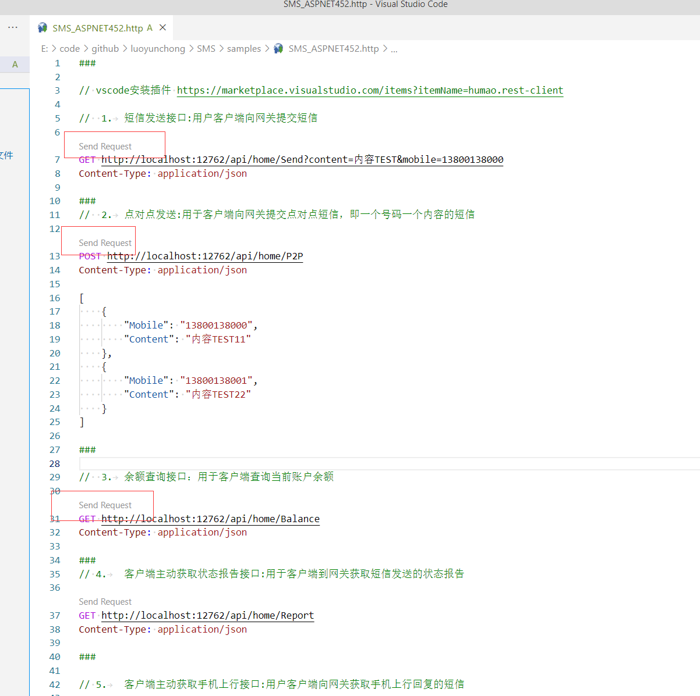

**English** | [简体中文](README.md)

### Qixintong SMS client API documentation

- SMGW stands for SMS gateway
- SMGW: SMS Gateway

```
下发地址：http(s)://ip:port/api/sm57/sms?action=send
点对点地址：http://host:port/sms?action=p2p
余额地址：http(s)://ip:port/api/sm57/sms?action=balance
报告地址：http(s)://ip:port/api/sm57/sms?action=report
上行地址：http(s)://ip:port/api/sm57/sms?action=mo
统计地址：http://host:port/api/sm57/sms?action=statis
```

See the [English SMS57-SMGW interface reference](../../docs/SMS57-SMGW.en.md) ([Chinese original](../../docs/SMS57-SMGW-客户接口说明文档.docx))

The API appears to be provided by Tongqiubao at [http://tqiu.cn/](http://tqiu.cn/); the source documentation was supplied during implementation.

## Nuget Packages

| Package name| Version| Downloads| Supported platforms                                                                         |
|  ------------ |  ------------ |  ------------ | ------------|
| `IGeekFan.SMS57_SMGW` | [](https://www.nuget.org/packages/IGeekFan.SMS57_SMGW/) |  |.NET4.5.2/.NETStandard2.0


## Usage

### .NET Core

Install the package
```console
dotnet add package IGeekFan.SMS57_SMGW
```

appsettings.json configuration
```json
 "SMGW_Option": {
    "SmsUrl": "http://116.236.156.232:8010", //根据服务商提供
    "UserName": "",
    "Password": ""
  }
```
- SmsUrl SMS sending URL supplied by the provider
- UserName username
- Password credential

```csharp
builder.Services.Configure<SMGW_Option>(builder.Configuration.GetSection("SMGW_Option"));

builder.Services.AddTransient<SMSGatewayClient>();
```

```csharp

app.MapGet("/Send", (SMSGatewayClient sms, string content, string mobile) =>
{
    return sms.Send(new SendRequest() { Extno = "1069012345", Content = content, Mobile = mobile });
});
app.MapPost("/p2p", (SMSGatewayClient sms, [FromBody] List<P2PMessage> mobileContentList) =>
{
    return sms.P2P(new P2PRequest() { Extno = "1069012345", mobileContentList = mobileContentList });
});
app.MapGet("/Balance", (SMSGatewayClient sms) =>
{
    return sms.Balance(new BaseRequest() { });
});

app.MapGet("/Report", (SMSGatewayClient sms) =>
{
    return sms.Report(new ReportRequest() { });
});

app.MapGet("/Mo", (SMSGatewayClient sms) =>
{
    return sms.Mo(new ReportRequest() { });
});
app.MapPost("/Statis", (SMSGatewayClient sms, [FromBody] StatisRequest req) =>
{ 
    return sms.Statis(req);
});

```


### .NET FrameWork

Install the package
```console
Install-Package IGeekFan.SMS57_SMGW
```

appSettings configuration in web.config
```xml
<add key="SmsUrl" value="http://xxxx:8010" />
<add key="UserName" value="UserName" />
<add key="Password" value="Password" />
```

Call 

```csharp
[RoutePrefix("api/home")]
public class HomeController : ApiController
{
    private readonly SMGW_Option smsOption = new SMGW_Option()
    {
        SmsUrl = ConfigurationManager.AppSettings["SmsUrl"].ToString(),
        UserName = ConfigurationManager.AppSettings["UserName"].ToString(),
        Password = ConfigurationManager.AppSettings["Password"].ToString()
    };

    [Route("Send")]
    [HttpGet]
    public SendReponse Send(string content, string mobile)
    {
        var sms = new SMSGatewayClient(smsOption);
        return sms.Send(new SendRequest() { Extno = "1069012345", Content = content, Mobile = mobile });
    }

    [Route("P2P")]
    [HttpPost]
    public P2PResponse P2P(List<P2PMessage> mobileContentList)
    {
        var sms = new SMSGatewayClient(smsOption);
        return sms.P2P(new P2PRequest() { Extno = "1069012345", mobileContentList = mobileContentList }); ;
    }

    [Route("Balance")]
    [HttpGet]
    public BalanceResponse Balance()
    {
        var sms = new SMSGatewayClient(smsOption);
        return sms.Balance(new BaseRequest() { });
    }

    [Route("Report")]
    [HttpGet]
    public ReportResponse Report()
    {
        var sms = new SMSGatewayClient(smsOption);
        return sms.Report(new ReportRequest() { });
    }

    [Route("Mo")]
    [HttpGet]
    public ReportResponse Mo()
    {
        var sms = new SMSGatewayClient(smsOption);
        return sms.Mo(new ReportRequest() { });
    }

    [Route("Statis")]
    [HttpPost]
    public StatisResponse Statis([FromBody] StatisRequest req)
    {
        var sms = new SMSGatewayClient(smsOption);
        return sms.Statis(req);
    }
}
```

## Customize logging in ASP.NET MVC

By default, logging uses `Trace.TraceInformation`. Implement `IGeekFan.SMS.Core.ILogger` to customize logging. The example below creates a log directory and writes dated logs; you can provide your own implementation.

```csharp
/// <summary>
/// 自定义日志
/// </summary>
public class ErrLog : IGeekFan.SMS.Core.ILogger
{
    public static ErrLog Instance = new Lazy<ErrLog>(() => new ErrLog()).Value;

    protected ErrLog()
    {
    }

    public void LogInformation(string message)
    {
        if (!Directory.Exists(HttpContext.Current.Server.MapPath("~/log")))
        {
            Directory.CreateDirectory(HttpContext.Current.Server.MapPath("~/log"));
        }
        string filename = HttpContext.Current.Server.MapPath("~/log/error" + DateTime.Now.ToString("yyyyMMdd") + ".log");
        TextWriter f = new StreamWriter(filename, true, Encoding.UTF8);
        f = TextWriter.Synchronized(f);
        f.WriteLine("LogInformation:" + DateTime.Now.ToString("yyyy-MM-dd HH:mm:ss") + " " + message);
        f.Close();
    }
}
```
Pass `ErrLog.Instance` when constructing SMSGatewayClient. Calls to `Balance` will then use the custom logging implementation.
```csharp
[Route("Balance")]
[HttpGet]
public BalanceResponse Balance()
{
    var sms = new SMSGatewayClient(smsOption, ErrLog.Instance);
    return sms.Balance(new BaseRequest() { });
}
```

## Complete code example

- [/samples/SMS_ASPNET452/Controllers/HomeController.cs](../../samples/SMS_ASPNET452/Controllers/HomeController.cs)
- [/samples/SMS_ASPNET452/Controllers/ErrLog.cs](../../samples/SMS_ASPNET452/Controllers/ErrLog.cs)


## .NET Framework endpoint testing

After configuration, run the SMS_ASPNET452 project. Its default port is `12762`.

Install the VS Code extension [https://marketplace.visualstudio.com/items?itemName=humao.rest-client](https://marketplace.visualstudio.com/items?itemName=humao.rest-client),

Open [SMS_ASPNET452.http](../../samples/SMS_ASPNET452.http) in VS Code and trust the workspace; then click Send Request to call the API.

